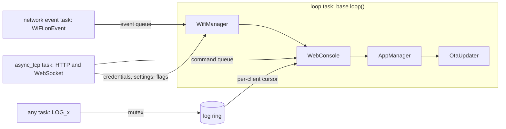

# Architecture

[Home](Home.md) / Architecture

esp-base is a framework: it owns the boot sequence, the loop and the device-wide singletons, and the project plugs in. That is what makes a fresh board work in two lines, and it is why the optional parts have compile-time switches and why everything is in `namespace espbase`.

## Modules

| Module | Responsibility | Source | Switch |
| --- | --- | --- | --- |
| `EspBase` | Facade. Owns the modules, runs `begin()` and `loop()`, built-in commands, device info, status LED, NTP, deferred reboot. | `EspBase.*` | |
| `Log` | `LOG_x` macros, serial sink, ring buffer. | `Log.*` | |
| `ConfigStore`, `Keys` | Mutex protected wrapper over `Preferences` (NVS); the persisted key names. | `ConfigStore.*`, `Keys.*` | |
| `Console` | Command registry: `addCommand()`, `execute()`, `poll(Serial)`. | `Console.*` | |
| `WifiManager` | Radio modes, stored networks, state machine, AP with captive DNS, mDNS, scan. | `WifiManager.*` | |
| `WebConsole` | HTTP server, WebSocket, `/api` routes, embedded page, login. | `WebConsole.*`, `web/index_html_gz.h` | `ESPBASE_NO_WEB` |
| `OtaUpdater` | ArduinoOTA and, with the web console, `POST /update`. | `OtaUpdater.*` | `ESPBASE_NO_OTA` |
| `AppRegistry`, `AppManager` | App registration, lifecycle, scheduling, navigation. | `App.h`, `AppRegistry.cpp`, `AppManager.*` | `ESPBASE_NO_APPS` |
| `ChipInfo` | The only place with `SOC_*` and `CONFIG_IDF_TARGET` checks. | `ChipInfo.h` | |

Reach them through `base.console()`, `base.wifi()`, `base.config()`, `base.web()` (the `AsyncWebServer`), `base.webConsole()`, `base.apps()` and `base.ota()`.

`ChipInfo` is usable from project code too:

```cpp
ChipInfo::cores();      // 1 or 2
ChipInfo::hasBle();     // SOC_BLE_SUPPORTED
ChipInfo::hasUsbCdc();  // USB Serial/JTAG or USB OTG present
ChipInfo::name();       // "esp32s3"
ChipInfo::appCore();    // core the Arduino loop runs on: 1 on dual core, 0 on single core
```

## What the library sets on the core

These are process wide. A project that uses esp-base accepts them.

| Setting | Why |
| --- | --- |
| `WiFi.persistent(false)` | Credentials live in `ConfigStore`, not in the SDK's own NVS area. |
| `WiFi.setAutoReconnect(false)` | Reconnects are scheduled by the state machine, with backoff and AP fallback. |
| `WiFi.onEvent(...)` | One handler that queues events for the loop task. Yours can be added next to it. |
| `WiFi.setHostname()` | From `cfg.hostname` or the stored `hostname` key. |
| `DefaultHeaders` of ESPAsyncWebServer | `X-Content-Type-Options`, `X-Frame-Options: DENY`, `Referrer-Policy` on every response, your routes included. |
| `ArduinoOTA`, `MDNS` | Owned by `OtaUpdater` and `WifiManager`. Add mDNS services with `MDNS.addService()` after the station is up. |
| SNTP | `configTzTime()` on every station connect while `cfg.ntpServer` is set. |

## Tasks and hand-offs

Only the loop task changes library state. The other tasks hand their work over.



What this means for your code:

- Console commands run on the loop task, whether they came from Serial or the browser. They may call any library API.
- HTTP handlers run on the async_tcp task. Keep them short and never block. For anything that changes device state, set a flag or push to a queue and act on it in `loop()`, the way the built-in routes do.
- `LOG_x` is safe from any task because logging never touches the network stack. It is not allowed from an ISR.
- Every route under `/api/`, plus `/ws` and `/update`, passes the origin check and, with a password, the login before its handler runs. Put routes that change state under `/api/`.

## One loop iteration

`base.loop()` runs these in order, and none of them waits:

1. `WifiManager` starts the driver on the first call, drains WiFi events, applies queued credential and setting changes, runs its timers.
2. `WebConsole` handles WebSocket connects, runs pending commands, streams new log lines, drops the oldest client beyond the limit.
3. `AppManager` delivers input, ticks apps, draws, applies one navigation transition, checks the idle timeout.
4. `OtaUpdater` runs `ArduinoOTA.handle()` and reboots after a finished web upload.
5. Status LED and any scheduled reboot.

`begin()` returns within a few milliseconds. The WiFi driver starts on the first `loop()` call. `base.console().poll(Serial)` is the project's call, after `base.loop()`.

## Rules

The library follows these, and code built on it should too:

1. Nothing blocks. No `delay()` in loop paths, no waiting for the network.
2. The library never touches `Serial`. It writes to the `Print*` in `cfg.logOutput` and reads commands from whatever `Stream` the project passes to `poll()`.
3. No GPIO numbers in `src/`. Pins come from the project.
4. Chip differences go through `ChipInfo` and `SOC_*` capability macros, never chip names. No literal core ids; use `ChipInfo::appCore()`.
5. Partitions, PSRAM and USB flags belong to the project.
6. Warning free with `-Wall -Wextra` on every target.

## Resource budget

Measured on the bundled examples:

| Item | Size |
| --- | --- |
| Static RAM | 45 to 56 KB depending on the chip |
| Flash, `examples/Minimal` | 1.12 MB (S2) to 1.26 MB (C6) |
| Flash saved by `ESPBASE_NO_WEB` | about 120 KB |
| Flash saved by `ESPBASE_NO_OTA` and `ESPBASE_NO_APPS` together | about 45 KB |
| Web page | about 6 KB gzipped, budget 20 KB |
| Log ring | 4 KB (`logBufferBytes`) |
| WebSocket clients | 4 (`maxWsClients`) |

Most of the flash is the core's WiFi stack; the library and its web server are a modest share of it. A 4 MB part with two OTA slots leaves about 600 KB per slot for the project.

## Design decisions

- The AP is open by default and the console login is optional, so first-time setup needs no password printed on the device. Set `apPassword` and `webPassword` before shipping; see [Security](Security.md).
- The app framework is for products with a UI. It separates the fundamentals from the application and gives apps a lifecycle, a scheduler and a navigation stack. A single purpose device writes everything in its sketch and never touches it; `-DESPBASE_NO_APPS` removes it.
- ArduinoJson parses the WebSocket and API input and builds `/api/info`. Hand-rolled parsing would be riskier.
- Versioning rules are in [Development](Development.md#versioning-and-release). The public API is the headers, the persisted keys, the commands, the routes and the WebSocket messages.
