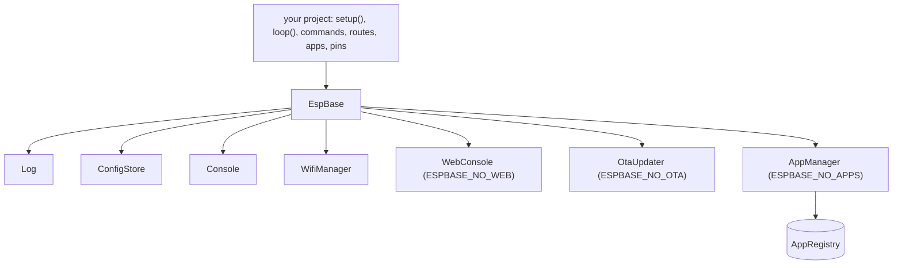

# esp-base wiki

esp-base is the common ground for ESP32 projects: WiFi with a captive portal fallback, a console on the serial port and in the browser with live logs and commands, OTA updates, persistent settings, structured logging, NTP time and an optional app framework. Your project keeps everything hardware specific: pins, display, input, partitions and USB flags.

It is a framework rather than a library. `base.begin(cfg)` takes over the boot sequence, the WiFi driver, the web server and the console; your project plugs in through the config struct, callbacks, commands, routes and apps. Everything is in `namespace espbase`.

| Page | Read it to |
| --- | --- |
| [Getting started](Getting-Started.md) | start a project from the template, in PlatformIO or the Arduino IDE, flash it, update it |
| [Architecture](Architecture.md) | understand the modules, the tasks, the rules they follow and what the library sets on the core |
| [WiFi](WiFi.md) | know how the device connects, falls back and retries |
| [Console and API](Console-and-API.md) | use the console, add commands and HTTP routes, bring your own UI |
| [Security](Security.md) | protect the device and know what stays with your project |
| [Apps](Apps.md) | build your application on the app framework |
| [Logging and config](Logging-and-Config.md) | log, persist settings, look up a key or config field |
| [Development](Development.md) | work on esp-base itself: build, web UI, tests, CI, release |
| [Troubleshooting](Troubleshooting.md) | fix a known symptom |

## At a glance

`EspBase` owns every module. You call `base.begin(cfg)` once and `base.loop()` forever; nothing blocks.

Targets: ESP32, ESP32-S3 and ESP32-C3 are hardware tested; ESP32-C6 and ESP32-S2 are build tested. Toolchain: Arduino core 3.x, in PlatformIO through pioarduino 55.03.311 (Arduino core 3.3.11, ESP-IDF 5.5.5). This wiki is the full documentation; the [README](../../README.md) has the overview and a quick start.
